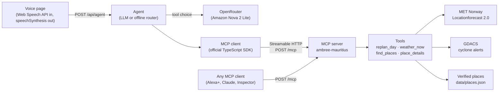

# Ambree for Alexa+

**Ambree's hyper-local Mauritius travel tools as an MCP server** (spec 2025-11-25, Streamable HTTP), plus a
**simulated Alexa+ voice page** that is a real MCP client of it. Say *"It's raining in Grand Baie. Re-plan my
afternoon."*: Ambree checks the live forecast, swaps the beach for covered places nearby, and says so in two sentences.

- **Live demo:** https://alexa.ambree.ai (the passcode is in the Devpost testing instructions)
- **MCP endpoint:** `https://alexa.ambree.ai/mcp` (open, no passcode)

## Quick start

Needs Node.js 22.18 or later (it runs TypeScript directly; there is no build step).

```bash
npm ci && npm start
```

Open http://localhost:8080. With **no key** it runs in **offline mode**: a keyword router picks the tool,
calls it over MCP and speaks its answer. Set `OPENROUTER_API_KEY` for **LLM mode**, where the model chooses the
tools (Amazon Nova 2 Lite through OpenRouter by default).

## Connect any MCP client

- **MCP Inspector:** run `npx @modelcontextprotocol/inspector`, choose *Streamable HTTP*, and enter
  `https://alexa.ambree.ai/mcp` (or `http://localhost:8080/mcp` locally).
- **Claude Code:** `claude mcp add --transport http ambree https://alexa.ambree.ai/mcp`
- **JSON config** (clients that take an `mcpServers` map):

```json
{
  "mcpServers": {
    "ambree": { "type": "http", "url": "https://alexa.ambree.ai/mcp" }
  }
}
```

An Agent Skill that tells an agent when to call each tool is in
[`skills/ambree-mauritius/SKILL.md`](skills/ambree-mauritius/SKILL.md).

## The 4 tools

All are read-only (`readOnlyHint: true`, `idempotentHint: true`), with titles, icons, and input and output schemas
listed as JSON Schema 2020-12. Every successful result has `structuredContent` plus the same JSON as text, including
a **`speech`** field: at most 2 sentences and 280 characters, written to be read aloud. A result with `isError: true`
has a short, readable text message only.

| Tool | What it does | Live feeds |
|---|---|---|
| `replan_day` | Keeps the plan, swaps it for up to 3 nearby covered places of different kinds (with approximate travel times), or says to stay safe when an orange or red cyclone alert affects Mauritius or is within 800 km. Trusts the traveller's own report about now: if the asked-for window is already over, it re-plans the rest of today (or, from 21:00, tomorrow from the forecast alone) and says so. From 17:00 (the dataset has no opening hours) it puts shopping centres within a 30-minute drive first and offers no drive over 45 minutes while a covered place within 30 exists; otherwise it asks to check the place is still open. From 15:00, heat means "keep to the shade until it cools off", not "the middle of the day". | MET Norway, GDACS |
| `weather_now` | Hourly forecast for an area (3 to 12 hours): rain timing, temperatures, wind, and cyclone alerts near the island. Says honestly when the feed is unavailable. | MET Norway, GDACS |
| `find_places` | Places from the verified dataset by area (accent-insensitive, and tolerant of one typo per 8 letters, a swap of two letters counting as one), kind, `rain_ok` and free text. In-area first, then within 25 km, nearest first. An area text that names a place uses that place's area and says so. | none |
| `place_details` | The full verified record for one place: what it is, how long to allow, rain suitability, source and check date. | none |

Bad arguments come back as a tool result with `isError: true` and a readable message (SEP-1303), so a model can
correct itself; an unknown or non-string tool name is a JSON-RPC error (-32602). JSON-RPC batches are refused
(400, -32600), as MCP removed batching in 2025-06-18.

## Architecture



- **No framework:** `node:http` plus `@modelcontextprotocol/sdk` and `zod` are the only direct runtime dependencies
  (the SDK brings its own transitive ones).
- **Stateless MCP:** a fresh `McpServer` and `StreamableHTTPServerTransport` per request, JSON responses.
- **The page is a real MCP client:** every tool call in a turn goes over HTTP to `/mcp`, and the
  *Under the hood* panel shows each call (tool, arguments, time, result).
- **Feeds are polite and robust:** MET Norway is cached until `Expires`, revalidated with `If-Modified-Since`,
  asked for 2-decimal coordinates with a descriptive User-Agent; both feeds have a 4 s timeout, a 1 MB cap,
  stale-if-error and a 5-minute back-off.
- **Guards:** Origin and Host checks (DNS rebinding), body limits, per-client token-bucket rate limits (IPv6 clients
  by /64), a CSP with no inline code, security headers, a daily LLM budget reserved before each call, at most 3 LLM
  turns in flight (1 per client), turns cancelled when the client goes away, and an optional passcode gate for the
  demo page.

## Built during the hackathon

The whole repository is new: it was started on 15 October 2026 for the Build, Ship, Shape hackathon (Alexa+ track),
and it is the first MCP-native piece of Ambree. The MET Norway and GDACS client logic is adapted from code the Ambree
team wrote before the hackathon; it was rewritten here as self-contained modules.

## Configuration

All variables are optional. Copy `.env.example` if you like; empty values count as unset.

| Variable | Default | Purpose |
|---|---|---|
| `PORT` | `8080` | Port to listen on. |
| `HOST` | all interfaces | Address to bind. |
| `PUBLIC_ORIGIN` | `http://localhost:<PORT>` | The public origin (e.g. `https://alexa.ambree.ai`). Allowed as Origin and Host; https turns on HSTS and a `Secure`, `__Host-` session cookie. |
| `ALLOWED_ORIGINS` | none | Extra allowed origins, comma-separated (their hostnames are also accepted as Host). |
| `TRUST_PROXY_HOPS` | `0` | Number of proxies in front. With N ≥ 1 the client IP is the N-th `X-Forwarded-For` entry from the right (a `:port` or `[ ]` around it is ignored). |
| `RATE_LIMIT_SCALE` | `1` | Multiplies every rate limit (`/mcp` 120/min burst 30, `/api/agent` 12/min burst 4, `/api/unlock` 5/min burst 5). For load tests and the e2e suite. |
| `DEMO_PASSCODE` | none | Puts the voice page behind a passcode. `/mcp` and `/healthz` stay open. A value made only of spaces fails at boot. Changing it ends every session. |
| `SESSION_SECRET` | none | Signs the session cookie. Required (32+ characters) when `DEMO_PASSCODE` is set. |
| `OPENROUTER_API_KEY` | none | Turns on LLM mode. |
| `AGENT_MODEL` | `amazon/nova-2-lite-v1` | OpenRouter model. |
| `AGENT_FALLBACK_MODELS` | `deepseek/deepseek-v4-flash` | Comma-separated fallbacks (`none` for none). |
| `AGENT_PRICE_IN_PER_M` / `AGENT_PRICE_OUT_PER_M` | `0.30` / `2.50` | USD per million tokens, used only when OpenRouter doesn't report `usage.cost`. |
| `AGENT_DAILY_USD` / `AGENT_DAILY_TURNS` | `0.50` / `300` | Daily (UTC) LLM caps; past them the agent answers in offline mode. Each LLM call first reserves the larger of its price-based worst case and the dearest call seen so far. |
| `MCP_URL` | `http://127.0.0.1:<PORT>/mcp` | The MCP endpoint the agent connects to; its host is accepted as Host. When it is loopback or the app's own `HOST`, the agent's calls carry a random per-process token that exempts them from the `/mcp` rate limit (unless a proxy relayed them). For any other host the token is not sent, and the agent's calls are rate-limited (logged once at boot). |
| `WEATHER_USER_AGENT` | `ambree-alexa/<version> (+https://alexa.ambree.ai)` | User-Agent sent to the feeds. |
| `FEEDS` | `on` | `off` disables both feeds; tools then report `unavailable`. |
| `PLACES_FILE` | `data/places.json` | The places dataset. |
| `MET_URL`, `GDACS_URL`, `OPENROUTER_URL` | the public APIs | Test only: point at local mock servers. |

`GET /healthz` returns `{ "ok": true, "version": "…" }` and accepts any Host, for health probes.

## Tests

```bash
npm run typecheck   # tsc --noEmit (strict, erasable syntax only)
npm test            # vitest: unit + integration against local mock MET, GDACS and OpenRouter servers
npm run test:e2e    # Playwright (Chromium): passcode gate, typed and chip turns, 360 px layout, screenshots
npm run check       # typecheck + test
```

Every test runs offline: **177 vitest tests** in 12 files and **8 Playwright tests**. They cover SDK conformance (the
SDK client negotiates `2025-11-25`; serverInfo, tools, 2020-12 schemas that the SDK client's Ajv compiles, icons),
the transport (405, batches, Origin and Host checks, protocol version, 413, 415, SEP-1303 errors), both feed
clients (Expires caching, 304, stale-if-error, back-off), `replan_day` decisions (including reports about now),
the agent (tool calls seen at `/mcp`, round caps, fallbacks, budget reservation, the in-flight caps, cancelled turns,
no user text in logs), rate limits, sessions, static files and the dataset invariants. The e2e suite also fails on any console error
or any request to another origin. `npm audit` reports 0 advisories, dev dependencies included.

## Data sources and licences

- **Weather:** Data from MET Norway, CC BY 4.0. We summarise it into spoken advice.
- **Cyclone alerts:** GDACS (United Nations and European Commission). Not an official warning: answers point to
  the Mauritius Meteorological Services.
- **Places:** `data/places.json`, the researched dataset: 50 places in 13 areas, curated for Ambree from the cited
  sources (facts plus our own words). Every place has an https `source` and a `verified_at` check date; tests check
  the dataset's invariants.
- **Fonts:** Instrument Serif, Instrument Sans and IBM Plex Mono, SIL OFL 1.1, self-hosted.

Details in [`NOTICE.md`](NOTICE.md).

## Privacy

- The voice page makes **no third-party requests**: fonts and images are self-hosted, and the CSP allows only this origin.
- Voice input uses your browser's speech recognition; **in Chrome, audio is processed by Google**. Speech output
  uses your device's voices.
- We don't store what you say. The conversation lives in the page and is gone on reload. The server logs one line
  per request with the route, status, timing, mode and tool names, and **never** your text, replies, IP address,
  cookies or keys.
- In LLM mode your question goes to OpenRouter with `provider.data_collection: "deny"`.

## Licence

MIT, see [`LICENSE`](LICENSE). Friction we hit with the MCP SDK and spec is in [`FRICTION.md`](FRICTION.md);
product feedback is in [`FEEDBACK.md`](FEEDBACK.md).
